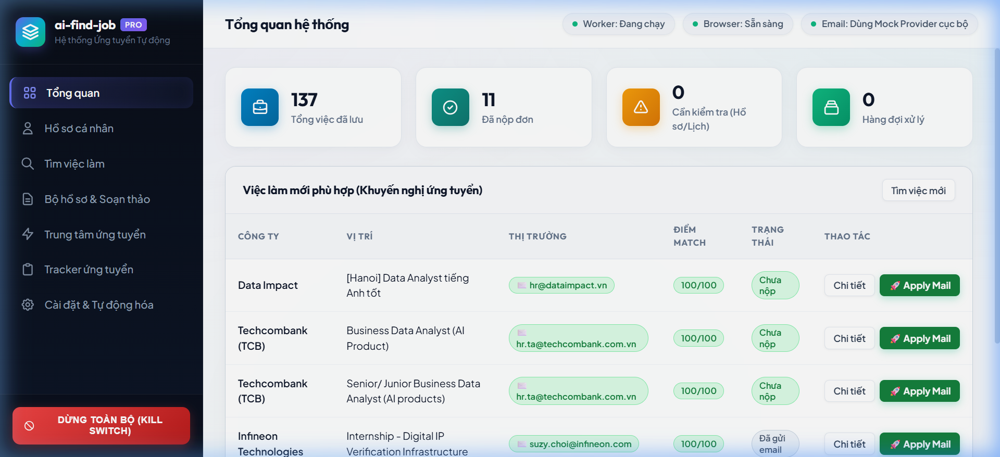
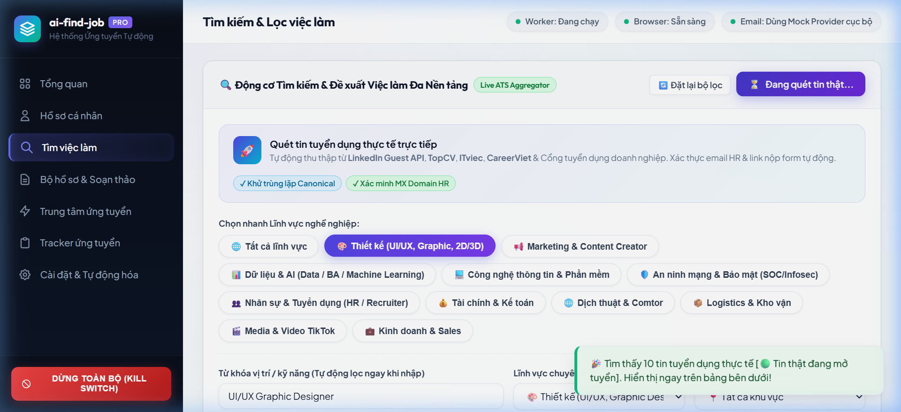
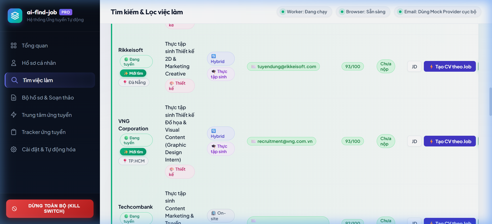
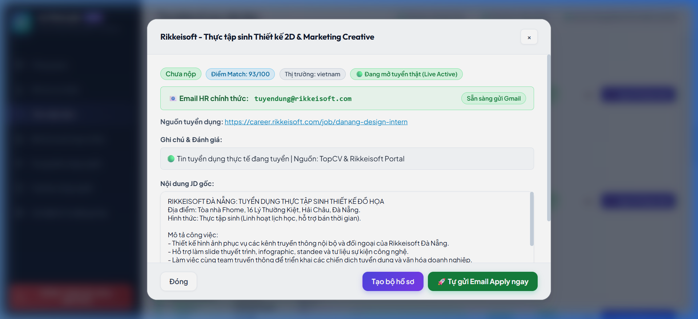

# 🚀 ai-find-job (ai-job-search)

> **Trợ lý Thông minh Tìm kiếm Việc làm Đa Lĩnh vực, May đo Hồ sơ CV theo từng Job & Hỗ trợ Ứng tuyển Tự động trên Windows**

[](https://www.python.org/)
[](LICENSE)
[](https://microsoft.com)
[]()
[]()

---

## 📖 MỤC LỤC

1. [🌟 Giới thiệu & Điểm nổi bật](#1--giới-thiệu--điểm-nổi-bật)
2. [⚡ Bắt đầu Nhanh trong 2 Phút (Quick Start)](#2--bắt-đầu-nhanh-trong-2-phút-quick-start)
3. [🎯 11 Lĩnh vực Nghề nghiệp Hỗ trợ](#3--11-lĩnh-vực-nghề-nghiệp-hỗ-trợ)
4. [📄 May đo CV & Cover Letter theo từng Job](#4--may-đo-cv--cover-letter-theo-từng-job)
5. [🤖 Hai Phương thức Ứng tuyển Tự động](#5--hai-phương-thức-ứng-tuyển-tự-động)
6. [🖥️ Trải nghiệm Giao diện Web (Web UI Guide)](#6-️-trải-nghiệm-giao-diện-web-web-ui-guide)
7. [⌨️ Bộ Công cụ Dòng lệnh (CLI Reference)](#7-️-bộ-công-cụ-dòng-lệnh-cli-reference)
8. [🔒 Cam kết Trung thực & Bảo mật Riêng tư](#8--cam-kết-trung-thực--bảo-mật-riêng-tư)
9. [🧪 Kiểm thử Tự động & Tích hợp Upstream](#9--kiểm-thử-tự-động--tích-hợp-upstream)
10. [📂 Cấu trúc Thư mục Dự án](#10--cấu-trúc-thư-mục-dự-án)

---

## 1. 🌟 GIỚI THIỆU & ĐIỂM NỔI BẬT

**ai-find-job** là giải pháp phần mềm toàn diện giúp người tìm việc (đặc biệt là sinh viên, thực tập sinh và lập trình viên) tự động hóa toàn bộ quy trình: từ **tìm kiếm tin tuyển dụng thực tế**, **phân tích JD**, **may đo CV cá nhân hóa theo từng công việc**, cho đến **nộp đơn qua Gmail HR** hoặc **hỗ trợ điền form web 1-click**.

### 💎 Điểm nổi bật hàng đầu:
* **Quét tin tuyển dụng thực tế (Live Jobs):** Tích hợp công cụ tìm kiếm đa nền tảng (Google Jobs, TopCV, CareerBuilder, LinkedIn, Jobstreet).
* **Đa dạng 11 nhóm ngành nghề:** Không chỉ giới hạn trong CNTT/Bảo mật mà mở rộng sang Thiết kế UI/UX, Marketing, Dữ liệu & AI, Nhân sự, Tài chính, Dịch thuật, Logistics, Media, Sales.
* **May đo CV chuẩn xác 100% (Zero Fabrication):** Mỗi công việc đều có một bản CV Modern Tech và Cover Letter riêng biệt. Định hướng tóm tắt năng lực và sắp xếp kỹ năng phù hợp nhất với JD, đồng thời **tuyệt đối không bịa đặt kinh nghiệm giả**.
* **Tìm kiếm thời gian thực (Real-time Live Filter):** Gõ từ khóa tới đâu lọc ngay tới đó; tin tuyển dụng mới tìm thấy được đánh dấu huy hiệu `✨ Mới tìm` và tự động đưa lên đầu bảng.
* **Gửi Email Apply 1-Click:** Tự động phát hiện email HR từ JD, sinh thư xin việc chuyên nghiệp, đính kèm CV PDF và gửi trực tiếp qua Gmail.
* **Hỗ trợ điền Form thông minh (Form Assist Modal):** Với các công việc không có email HR, hệ thống tự mở link tuyển dụng và cung cấp bảng sao chép thông tin cá nhân 1-click cực kỳ tiện lợi.
* **Bảo mật tuyệt đối (100% Local-First):** Dữ liệu cá nhân lưu trữ an toàn trên máy bạn, được `.gitignore` bảo vệ, không bao giờ gửi ra ngoài nếu chưa có sự cho phép.

---

## 2. ⚡ BẮT ĐẦU NHANH TRONG 2 PHÚT (QUICK START)

### Yêu cầu hệ thống:
* **Hệ điều hành:** Windows 10 / Windows 11
* **Môi trường:** Python 3.11 trở lên
* **Trình duyệt:** Google Chrome / Edge

### Bước 1: Khởi động Ứng dụng Giao diện Web
Mở PowerShell tại thư mục dự án và chạy lệnh sau:
```powershell
python -m src.launcher
```
> Trình duyệt sẽ tự động mở trang chủ tại địa chỉ: **`http://127.0.0.1:8000/`**

### Bước 2: Thiết lập Hồ sơ Cá nhân
* Vào tab **Hồ sơ cá nhân** trên thanh menu bên trái.
* Nhập thông tin của bạn: Họ tên, Email, Số điện thoại, Trường học, Kỹ năng, Dự án thực tế.
* Bấm **Lưu hồ sơ cá nhân**. Dữ liệu sẽ được lưu an toàn tại `data/candidates/my_profile.json`.

### Bước 3: Tìm việc & Tạo CV theo từng Job
* Vào tab **Tìm việc làm**.
* Chọn nhanh một trong **11 Lĩnh vực nghề nghiệp** (ví dụ: *📊 Dữ liệu & AI* hoặc *🎨 Thiết kế*).
* Bấm **Tìm kiếm việc ngay**.
* Tại từng dòng công việc trong bảng kết quả:
  * Bấm **`⚡ Tạo CV theo Job`** để tạo ngay bộ hồ sơ cá nhân hóa cho công việc đó.
  * Hoặc bấm **`⚡ Tự động tạo CV cho tất cả việc này`** để tạo hàng loạt.
  * Bấm **`📄 Xem CV`** để xem trước bản in PDF và nội dung thư ứng tuyển.
* Bấm **`🚀 Gửi Email`** (nếu có email HR) hoặc **`📝 Nộp Form`** để hoàn tất nộp đơn!

---

## 3. 🎯 11 LĨNH VỰC NGHỀ NGHIỆP HỖ TRỢ

Hệ thống tích hợp bộ nhận diện từ khóa thông minh (`Smart Inferred Category`) và cung cấp 11 danh mục chọn nhanh:

| Icon | Lĩnh vực chuyên môn | Vị trí công việc & Kỹ năng tiêu biểu |
| :---: | :--- | :--- |
| 🎨 | **Thiết kế sáng tạo** | UI/UX Designer, Graphic Design, Figma, Design System, Wireframe, Adobe Photoshop, 2D/3D |
| 📢 | **Marketing & Truyền thông** | Digital Marketing, Content Creator, SEO, Chạy Ads Facebook/Google, Social Media |
| 📊 | **Dữ liệu & Trí tuệ nhân tạo** | Data Analyst, Business Analyst (BA), SQL, Python Data, Machine Learning, Power BI |
| 💻 | **Công nghệ thông tin** | Software Engineer, Lập trình Web/Mobile, Frontend (React/Vue), Backend (Node/Python/Java) |
| 🛡️ | **An toàn & An ninh mạng** | SOC Analyst, Chuyên viên Giám sát ATTT, Phân tích mã độc, Quản trị Mạng, SIEM |
| 👥 | **Nhân sự & Tuyển dụng** | IT Recruiter, HR Intern, Chuyên viên Đào tạo, Quản lý Nhân sự & Quan hệ lao động |
| 💰 | **Tài chính & Kế toán** | Kế toán tổng hợp, Financial Analyst, Báo cáo thuế, Kiểm toán nội bộ, Excel tài chính |
| 🌐 | **Dịch thuật & Biên phiên dịch** | IT Comtor (Nhật/Hàn/Anh), Biên dịch tài liệu kỹ thuật, Bản địa hóa sản phẩm |
| 📦 | **Logistics & Chuỗi cung ứng** | Quản trị Logistics, Xuất nhập khẩu (XNK), Chứng từ hải quan, Quản lý kho bãi |
| 🎬 | **Truyền thông số & Media** | Video Editor, Premiere Pro, CapCut, Sáng tạo kịch bản video TikTok / YouTube Shorts |
| 💼 | **Kinh doanh & Phát triển thị trường** | B2B Sales, Business Development (BD), Telesales, Chăm sóc khách hàng (CSKH) |

---

## 4. 📄 MAY ĐO CV & COVER LETTER THEO TỪNG JOB

### Nguyên tắc Vàng: May đo Cá nhân hóa nhưng Tuyệt đối Trung thực (Zero Fabrication)
Thay vì dùng 1 bản CV chung chung gửi cho mọi công ty, **ai-find-job** tự động tùy biến từng tài liệu cho phù hợp với từng JD tuyển dụng:

1. **Professional Summary thích ứng:**
   * Tự động điều chỉnh mục tiêu và định hướng để làm nổi bật sự quan tâm sâu sắc tới vị trí ứng tuyển.
   * Kết nối tư duy công nghệ, năng lực tự nghiên cứu và các chứng chỉ thực tế (như *Google Gemini Certified Student*, *Rikkei Education*).
2. **Sắp xếp thứ tự nhóm kỹ năng theo trọng tâm của JD:**
   * Vị trí **Dữ liệu / AI**: Ưu tiên nhóm kỹ năng SQL, Phân tích dữ liệu và Lập trình Python lên đầu.
   * Vị trí **Thiết kế**: Ưu tiên trải nghiệm người dùng, Mobile App Architecture và Design System.
   * Vị trí **An ninh mạng**: Ưu tiên Giám sát mạng, TCP/IP, Wireshark, Linux Hardening và Bảo mật.
3. **Định dạng Modern Tech & ATS-Friendly:**
   * Xuất bản giao diện chuẩn **Modern Tech** (thanh lịch, trang nhã, phông chữ Inter hiện đại).
   * Tương thích tuyệt đối với các hệ thống lọc hồ sơ tự động **ATS (Applicant Tracking System)**.
   * Hỗ trợ xem trực tiếp trên Web và in ra file PDF hoàn hảo (`Ctrl + P`).

---

## 5. 🤖 HAI PHƯƠNG THỨC ỨNG TUYỂN TỰ ĐỘNG

| Kênh nộp | Cách nhận diện | Quy trình xử lý của hệ thống |
| :--- | :--- | :--- |
| **✉️ Kênh Email HR (1-Click)** | JD có chứa địa chỉ email của nhà tuyển dụng hoặc HR | 1. Hệ thống tự động trích xuất email HR chính thức.<br>2. Soạn thư xin việc chuyên nghiệp bằng tiếng Việt hoặc tiếng Anh.<br>3. Đính kèm bản CV PDF vừa tạo.<br>4. Gửi trực tiếp qua Gmail SMTP an toàn và cập nhật Tracker thành **Đã nộp đơn**. |
| **🌐 Kênh Form / Link ngoài** | JD là link nộp trên website tuyển dụng (TopCV, CareerLink,...) | 1. Hệ thống mở form trên tab mới của trình duyệt.<br>2. Cửa sổ **Form Helper Modal** hiện ra với đầy đủ thông tin ứng viên.<br>3. Bạn chỉ cần bấm nút `📋 Sao chép` một chạm cho từng trường (Họ tên, SĐT, Email, Link GitHub/LinkedIn).<br>4. Tải file CV PDF về để đính kèm lên form và bấm `✅ Tôi đã nộp xong`. |

---

## 6. 🖥️ TRẢI NGHIỆM GIAO DIỆN WEB (WEB UI GUIDE)

Giao diện Web được thiết kế theo phong cách Modern Frosted Glassmorphism với bộ font Google Fonts (*Outfit* & *Plus Jakarta Sans*), màu sắc công nghệ cao cấp và micro-animations mượt mà:

<p align="center">
  
</p>

### 📸 Hình ảnh các tính năng cốt lõi trên giao diện:

| Phân hệ | Hình ảnh giao diện thực tế | Điểm nổi bật & Thao tác |
| :--- | :---: | :--- |
| **1. Tổng quan (Dashboard)** |  | Thống kê KPI số lượng việc đã lưu, đã nộp, việc cần chú ý, hàng đợi tự động và danh sách việc mới khuyến nghị. |
| **2. Tìm việc làm đa nền tảng** |  | Chọn nhanh 11 lĩnh vực, quét LinkedIn / TopCV / ITviec, gõ từ khóa lọc tức thì, gắn huy hiệu `✨ Mới tìm` và `🟢 Đang tuyển`. |
| **3. Bảng kết quả & Tạo CV theo Job** |  | Hiển thị kênh nộp (Email HR / Nộp Form), điểm Match, nút **`⚡ Tạo CV theo Job`** và **`🚀 Gửi Email 1-Click`**. |
| **4. Modal Chi tiết JD & Nộp đơn** |  | Modal xem trọn vẹn mô tả JD, trích xuất email HR chính thức, nút gửi đơn trực tiếp hoặc hỗ trợ điền form. |

7 phân hệ chính trên thanh điều hướng bên trái:
1. **Tổng quan (Dashboard):** Trung tâm theo dõi toàn diện với chỉ số KPI và trạng thái hệ thống.
2. **Hồ sơ cá nhân (Profile):** Quản lý hồ sơ gốc, học vấn, kỹ năng, dự án thực tế và ảnh chân dung.
3. **Tìm việc làm (Job Search):** Động cơ tìm việc đa nền tảng, 11 nhóm ngành nghề và bộ lọc vị trí/hình thức.
4. **Bộ hồ sơ & Soạn thảo (Packages):** Xem trực tiếp bản CV HTML/PDF trên iframe, chỉnh sửa thư xin việc.
5. **Hàng đợi ứng tuyển (Queue):** Quản lý tiến trình gửi email và điền form tự động với cơ chế an toàn.
6. **Theo dõi đơn ứng tuyển (Tracker):** Bảng quản lý trạng thái hồ sơ ứng tuyển, hỗ trợ xuất file CSV.
7. **Cài đặt & Tự động hóa (Settings):** Cấu hình tài khoản email SMTP, kiểm tra kết nối Playwright và hệ thống.

---

## 7. ⌨️ BỘ CÔNG CỤ DÒNG LỆNH (CLI REFERENCE)

Ngoài giao diện Web, bạn có thể thực hiện mọi tác vụ trực tiếp qua PowerShell:

### Đánh giá JD & May đo hồ sơ:
```powershell
# Đánh giá JD tại Việt Nam và sinh bộ hồ sơ hoàn chỉnh
python -m src.cli evaluate --file data/my_jd.txt --candidate data/candidates/my_profile.json --market vietnam --save-track --generate-docs

# Đánh giá JD thị trường Hàn Quốc (xác minh visa E-7/D-10)
python -m src.cli evaluate --file tests/fixtures/jd_korea_security.txt --market korea --save-track --generate-docs

# Đánh giá nhanh từ văn bản trực tiếp (100% offline)
python -m src.cli evaluate --text "Tuyển dụng Data Analyst Intern tại Đà Nẵng..." --market vietnam
```

### Quản lý Tracker ứng tuyển:
```powershell
# Liệt kê tất cả công việc đang theo dõi
python -m src.cli tracker list

# Cập nhật trạng thái ứng tuyển
python -m src.cli tracker update --id job_66c0e0 --status "Đã nộp" --notes "Đã gửi email kèm CV"

# Xuất toàn bộ dữ liệu ra file CSV
python -m src.cli tracker export
```

### Lọc trùng tin tuyển dụng (Deduplication):
```powershell
python -m src.cli deduplicate --file tests/fixtures/jd_duplicates.json
```

---

## 8. 🔒 CAM KẾT TRUNG THỰC & BẢO MẬT RIÊNG TƯ

1. **Bảo mật Dữ liệu Riêng tư (Data Privacy First):**
   * File hồ sơ thực tế (`my_profile.json`), lịch sử ứng tuyển (`jobs_tracker.*`) và thư mục tài liệu xuất ra (`output/`) đã được cấu hình trong `.gitignore`.
   * **Không có dữ liệu cá nhân nào bị đưa lên GitHub.**
2. **Trung thực về Hồ sơ (Factual Integrity):**
   * Tuyệt đối không bịa đặt số năm kinh nghiệm, kỹ năng hay chứng chỉ không có thực.
   * Phân biệt rành mạch giữa: Môn học (Coursework), Bài thực hành (Lab & Simulation), Đồ án cá nhân (Personal Projects) và Kinh nghiệm thực tế (Work Experience).
   * Áp dụng chính sách **Zero GPA** để tập trung vào năng lực thực chiến và sản phẩm thực tế.
3. **Cơ chế Kill Switch Dừng Khẩn cấp:**
   * Nút **`DỪNG TOÀN BỘ (KILL SWITCH)`** màu đỏ luôn hiện hữu trên thanh điều hướng để ngắt toàn bộ tiến trình gửi email hoặc tác vụ nền ngay lập tức khi cần.

---

## 9. 🧪 KIỂM THỬ TỰ ĐỘNG & TÍCH HỢP UPSTREAM

Dự án duy trì hệ thống kiểm thử tự động toàn diện, đảm bảo không có lỗi hồi quy (zero regression):

```powershell
# 1. Chạy toàn bộ 37 ca kiểm thử của dự án (100% PASS)
python -m unittest tests.test_all

# 2. Chạy riêng bộ kiểm thử may đo CV Modern Tech
python -m unittest tests.test_modern_tech_cv

# 3. Kiểm tra an toàn chuỗi cung ứng Upstream
python -m src.cli upstream-verify

# 4. Chạy kiểm thử kho nguồn Upstream gốc
python -m unittest discover -s upstream/tests -p "test_*.py"
```

---

## 10. 📂 CẤU TRÚC THƯ MỤC DỰ ÁN

```text
ai-find-job/
├── .agents/                    # Cấu hình Skills & Rules dành cho AI Agent
│   └── skills/ai-job-search/   # Skill điều khiển Antigravity
├── data/
│   ├── candidates/             # Hồ sơ ứng viên mẫu & hồ sơ thực tế
│   │   ├── candidate_mock.json # Hồ sơ mẫu chuẩn hóa
│   │   └── my_profile.json     # Hồ sơ cá nhân của bạn (được bảo vệ)
│   └── my_jd.txt               # File chứa nội dung JD cần phân tích nhanh
├── src/
│   ├── cli.py                  # Điểm vào điều khiển dòng lệnh (CLI)
│   ├── db.py                   # Cơ sở dữ liệu SQLite lưu trữ việc làm & hồ sơ
│   ├── evaluator.py            # Động cơ phân tích & chấm điểm JD
│   ├── launcher.py             # Script khởi động Web UI một chạm
│   ├── modern_tech_cv.py       # Động cơ may đo CV theo 11 lĩnh vực & chuẩn ATS
│   ├── multi_platform_searcher.py # Bộ quét tin tuyển dụng đa nền tảng
│   ├── tracker.py              # Quản lý trạng thái ứng tuyển & xuất CSV
│   ├── web_server.py           # REST API Web Server (FastAPI / Uvicorn)
│   └── web_ui/                 # Giao diện người dùng Web Frontend
│       ├── app.js              # Logic xử lý giao diện, lọc thời gian thực
│       ├── index.html          # Cấu trúc giao diện HTML5 chuẩn SEO
│       └── style.css           # Bảng màu sắc & hệ thống huy hiệu 11 lĩnh vực
├── tests/                      # Bộ kiểm thử tự động toàn diện
├── upstream/                   # Bản sao kho nguồn gốc (MIT License)
├── AGENTS.md                   # Chỉ dẫn bắt buộc dành cho Agent
└── README.md                   # Tài liệu hướng dẫn sử dụng dự án (File này)
```

---

## 👨‍💻 TÁC GIẢ & BẢN QUYỀN

* **Ứng viên / Lập trình viên:** Ngô Văn Hiền ([GitHub: @hien23ns](https://github.com/hien23ns))
* **Trường đào tạo:** Trường Đại học Công nghệ Thông tin và Truyền thông Việt - Hàn (VKU)
* **Giấy phép:** [MIT License](LICENSE) - Hoàn toàn mã nguồn mở, phục vụ cộng đồng sinh viên và người tìm việc.
